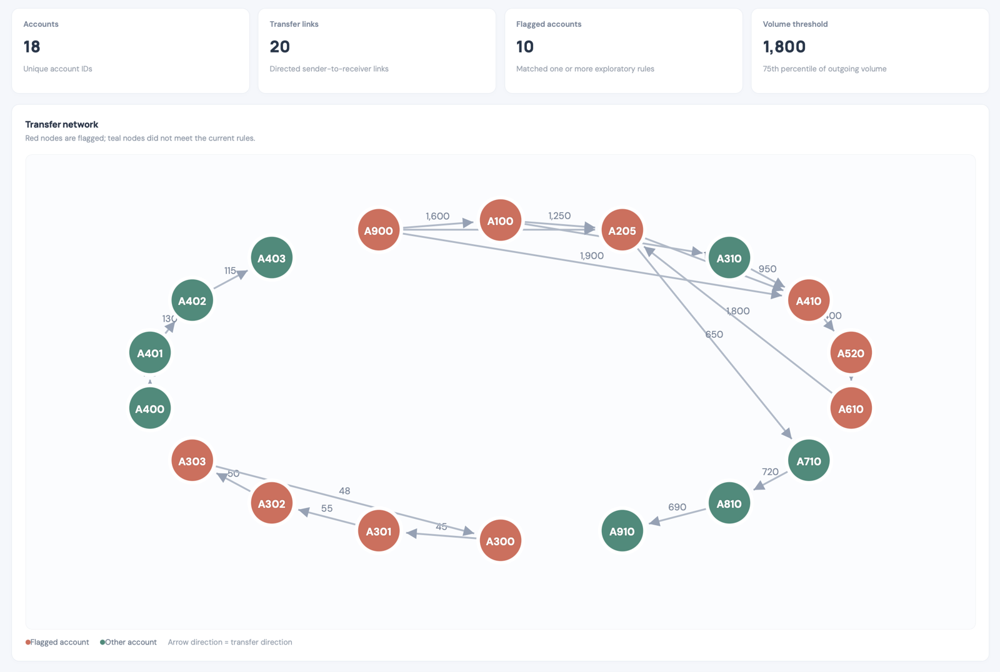
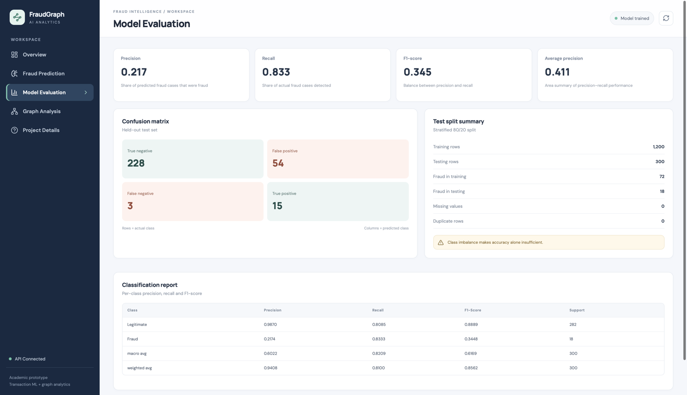

# FraudGraph AI



Look at the four accounts at the bottom of that graph. They pass around tiny amounts, 45 to 55 a hop, nowhere near the 1,800 volume threshold. Any rule that only watches how much money moves would ignore them. They're flagged because the money goes in a circle, and that's the point of this project: some fraud isn't visible in any single transaction. You only see it in the shape of the network.

FraudGraph AI puts two ways of looking at fraud in one app. A model scores individual card transactions. A graph view flags accounts that sit on loops or push unusual volume, with a reason attached to each flag. It started as a course project for *Machine Learning for Data Analytics* at SRM Institute of Science and Technology.

A hosted demo is at https://fraud-graph-ai-fullstack.vercel.app/. It's a lighter version than the code in this repo: you upload a CSV, it trains a logistic regression on the spot, and it shows a demo transfer graph. The features described below (saved XGBoost model, PaySim graph, investigation cases, Data Lab) are in the repo, not the hosted demo.

## Two datasets that refuse to merge

The best public datasets for this problem don't overlap.

The [credit-card dataset](https://www.kaggle.com/datasets/mlg-ulb/creditcardfraud) has 284,807 real transactions, but every feature is an anonymised PCA component and there are no account IDs. You can score a transaction. You can't ask who it's connected to.

[PaySim](https://www.kaggle.com/datasets/ealaxi/paysim1) has accounts and transfers between them, so you can build a network. But it's synthetic, so nothing about it proves how real fraud looks.

We kept them separate on purpose, and the app says so. The model only ever sees credit-card features. The graph only ever sees PaySim transfers. The graph score is a transparent heuristic built from how active an account is, how widely it fans money out, how much flows through it and when. Simulator fraud labels appear as context but never feed the score.

## Accuracy is a trap here

Only 492 of the 284,807 transactions are fraud. A model that answers "legitimate" every time is over 99.8% accurate and catches nothing. The saved model's own metadata carries that warning, so we don't use accuracy.

The saved model is a class-weighted XGBoost. On a held-out test set of 56,962 transactions with 98 frauds, it catches 83 and misses 15, with 13 false alarms (precision 0.865, recall 0.847). Its decision threshold is 0.325, not the default 0.5. We picked it on a separate validation split where a missed fraud counts ten times as costly as a false alarm, so the test set never influenced it.

In cross-validation the model metadata lists average precision for four candidates: XGBoost 0.851, a balanced random forest 0.850, XGBoost with SMOTE 0.847 and a balanced logistic regression 0.748. The top three are close.

The hosted demo's baseline shows why this matters. Trained on a small 1,500-row demo file, its logistic regression catches 15 of 18 frauds but raises 54 false alarms:



Treat all of these numbers with care. They come from an internal holdout of the same dataset, which isn't external validation, and 98 fraud cases is a small test set. A few cases either way would move the metrics.

## What's in the repo

- Credit-card transaction scoring with the saved model, per row or across a whole uploaded CSV
- A PaySim account graph with suspicion scores, reasons and source-row evidence
- Investigation cases stored in SQLite, so they survive restarts
- A Data Lab for uploading CSVs, with a quality summary
- Per-user API keys, with only a hash stored, and a small proxy that keeps the key out of the browser
- A "laptop mode" that offloads the heavy work (graph building, SHAP, full analysis) to a Colab notebook

The backend lives in `src/`, the dashboard in `fraudgraph-frontend/` and the Colab notebook in `colab/`. The full API reference and dataset notes are in [`docs/API_AND_DATASETS.md`](docs/API_AND_DATASETS.md).

## Run it

Put the datasets in `data/raw/`:

```bash
kaggle datasets download -d mlg-ulb/creditcardfraud -p data/raw --unzip
kaggle datasets download -d ealaxi/paysim1 -p data/raw --unzip
mv data/raw/PS_20174392719_1491204439457_log.csv data/raw/paysim.csv
```

Start the API from the repository root:

```bash
python3 -m pip install -r requirements.txt
FRAUDGRAPH_API_KEY=<server-side-key> python3 -m uvicorn src.api.main:app --reload
```

Then start the dashboard. It needs the proxy running too, and [`fraudgraph-frontend/README.md`](fraudgraph-frontend/README.md) walks through all three terminals:

```bash
cd fraudgraph-frontend
npm install
npm run dev
```

Tests: `pytest -q`

This is a single-user local app with no multi-user authorisation, so keep it on localhost.
